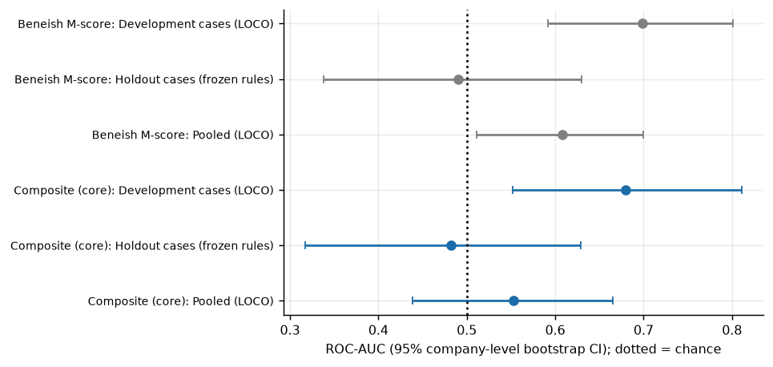
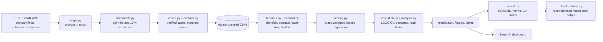

# Forensic Red-Flag Detector

> **Disclaimer.** This is a research and portfolio project. It is **not investment advice**. A "flag" means a filing
> resembles filings of companies that later restated; it indicates *elevated risk worth investigating*, **not proof of
> fraud, intent or wrongdoing**. Many flagged companies are honest, and most manipulators are not flagged.

## Summary

The tool screens US company financials from SEC EDGAR (XBRL) for accounting-manipulation signals - the Beneish M-score,
accruals quality, receivables-versus-revenue and earnings-versus-cash-flow divergence, and a Benford first-digit test -
and asks a practical question: *using only filings available before the problem became public, would these signals have
flagged real companies that later restated or faced SEC accounting action?* It is validated on **27 verified US
cases** with **80 matched healthy peers**, using leave-one-company-out cross-validation and company-level bootstrap
confidence intervals. To stop me fooling myself, the cases are split in two: **14 development cases** that I picked from memory and
studied while building the models, and **13 holdout cases** selected mechanically from SEC's Accounting and Auditing Enforcement
Release list under rules I committed to GitHub *before* scoring them (`docs/preregistration.md`), scored with rules frozen on the development set.
**Headline:** on the development cases the published Beneish M-score has a ROC-AUC of 0.70 (95% CI 0.59 to 0.80);
on the untouched holdout it scores 0.49 (95% CI 0.34 to 0.63). The M-score did no better than chance on unseen cases, so the development result did not generalise. My refitted composite never reliably beat the plain M-score.
With this few independent companies the study is a *case-study validation, not proof of predictive power*.

## Key results

All numbers below are written by `scripts/render_docs.py` from `reports/results.json`; `scripts/check_claims.py` fails the build if
this README disagrees with the code output. The table pools all 27 cases (development + holdout) under leave-one-company-out validation, i.e. every company is scored by a model that never saw it; CIs = 2000-replicate bootstrap over companies. The next section separates the cohorts.

| Model | ROC-AUC [95% CI] | PR-AUC [95% CI] | Recall (misstated 10-Ks) | False-positive rate (control 10-Ks) | Cases flagged pre-event |
|---|---|---|---|---|---|
| Beneish M-score > -1.78 (baseline) | 0.61 [0.51, 0.70] | 0.42 [0.30, 0.58] | 28% | 7% | 10 of 27 |
| Composite, 6 signals (pre-specified) | 0.55 [0.44, 0.67] | 0.34 [0.24, 0.50] | 21% | 12% | 8 of 27 |
| Composite + Benford + NI-CFO gap | 0.60 [0.50, 0.69] | 0.36 [0.25, 0.53] | 28% | 12% | 9 of 27 |
| M-score + 3 signals (post hoc, exploratory) | 0.44 [0.35, 0.52] | 0.28 [0.21, 0.40] | 21% | 11% | 8 of 27 |

* Evaluation sample: 47 misstated vs 137 control firm-years from 27 case and 80 control companies, so
  26% of rows are positives. That is far above any real-world base rate, so **precision figures flatter live
  performance**: at an assumed 1% prevalence the baseline's implied precision is 3.7% (at 5%: 16.6%).
  These implied figures are arithmetic on the sample's recall and false-positive rate, not measurements.
* The pre-specified composite was statistically indistinguishable from the published baseline (ROC-AUC difference -0.06, 95% CI -0.17 to 0.06).
* The extended composite was statistically indistinguishable from the published baseline (ROC-AUC difference -0.01, 95% CI -0.13 to 0.11).
* The post-hoc anchored composite ranked misstated years WORSE than the published baseline (ROC-AUC difference -0.17, 95% CI -0.25 to -0.10). (This variant was added *after* seeing the pre-specified model underperform, so it is exploratory.)
* Permutation p-values for ROC-AUC (labels shuffled across companies): baseline 0.016, composite 0.174.
  Only the baseline ranks misstated years better than chance would. Dropping any single case moves the baseline AUC within 0.59 to 0.62.
* Where each test stands alone (raw signal, higher = riskier):

| Signal (raw, higher = riskier) | ROC-AUC [95% CI] |
|---|---|
| mscore_ops | 0.61 [0.51, 0.70] |
| mscore | 0.61 [0.51, 0.70] |
| sgi | 0.58 [0.42, 0.73] |
| ni_cfo_gap_rev | 0.56 [0.46, 0.66] |
| tata_ops | 0.55 [0.45, 0.65] |
| ar_rev_gap | 0.54 [0.46, 0.62] |
| dsri | 0.54 [0.46, 0.62] |
| sloan_accruals | 0.53 [0.40, 0.65] |
| tata | 0.53 [0.44, 0.64] |
| total_accruals | 0.53 [0.43, 0.64] |
| sgai | 0.53 [0.42, 0.63] |
| lvgi | 0.52 [0.42, 0.61] |
| aqi | 0.51 [0.41, 0.60] |
| depi | 0.50 [0.41, 0.58] |
| gmi | 0.44 [0.34, 0.53] |
| benford_mad | 0.43 [0.33, 0.54] |

* **Benford:** the first-digit test did **not** separate misstated from control filings (median MAD 0.0144 vs 0.0155;
  43% vs 53% of filings "nonconforming"). Filings hold about 346 reported values, mostly
  sums and rounded totals, so it is a weak filing-level test and I would not use it alone.

### Does it generalise? The untouched holdout

| Model | Development cases (LOCO) | Holdout cases (frozen rules) | Pooled (LOCO) |
|---|---|---|---|
| Beneish M-score > -1.78: ROC-AUC [95% CI] | 0.70 [0.59, 0.80] | 0.49 [0.34, 0.63] | 0.61 [0.51, 0.70] |
| Composite, 6 signals: ROC-AUC [95% CI] | 0.68 [0.55, 0.81] | 0.48 [0.32, 0.63] | 0.55 [0.44, 0.67] |
| Beneish M-score > -1.78: recall / false-positive rate | 41% / 9% | 10% / 5% | 28% / 7% |
| Beneish M-score > -1.78: cases flagged before cut-off | 8 of 14 | 2 of 13 | 10 of 27 |
| Composite, 6 signals: recall / false-positive rate | 30% / 10% | 5% / 5% | 21% / 12% |
| Composite, 6 signals: cases flagged before cut-off | 7 of 14 | 1 of 13 | 8 of 27 |

* Holdout: 20 misstated and 60 control firm-years from 13 cases and 39 controls. The frozen composite's interval includes chance.
  Frozen composite minus baseline on the holdout: ROC-AUC difference -0.01 (95% CI -0.12 to 0.09). Permutation p-value for the baseline on the holdout: 0.548.
* The holdout cases are mechanical, so they include restatements the M-score has no reason to catch (for example a segment-reporting restatement that leaves consolidated numbers unchanged).
  That is the point: a prospective screen faces the same mixture.



| Holdout case | Misstated 10-Ks scored | Item 4.02 filed | Beneish flag: lead (yrs) | Composite flag: lead (yrs) |
|---|---|---|---|---|
| Maxwell Technologies | 1 | 2013-03-07 | not flagged | not flagged |
| MagnaChip Semiconductor Corporation | 1 | 2014-03-11 | 1.0 | not flagged |
| Logitech International | 2 | 2014-09-04 | not flagged | not flagged |
| Computer Sciences Corporation | 1 | 2014-12-29 | not flagged | not flagged |
| IEC Electronics Corp. | 1 | 2015-02-09 | not flagged | not flagged |
| Pyxus International | 2 | 2016-02-19 | not flagged | not flagged |
| Advanced Drainage Systems | 1 | 2016-11-29 | not flagged | not flagged |
| Manitex International | 1 | 2017-11-06 | not flagged | not flagged |
| PPG Industries | 1 | 2018-05-10 | not flagged | not flagged |
| BorgWarner Inc. | 3 | 2018-06-15 | not flagged | not flagged |
| HF Foods Group Inc. | 2 | 2023-01-20 | 2.8 | 2.8 |
| ReShape Lifesciences Inc. | 1 | 2023-04-13 | not flagged | not flagged |
| Archer-Daniels-Midland Company | 3 | 2024-11-05 | not flagged | not flagged |

### How often does the M-score flag an ordinary company?

Using the XBRL `frames` API, I scored **every US calendar-year filer with a classified balance sheet and complete inputs** (2,777 in 2015,
2,502 in 2019) and counted how many exceed the -1.78 cut-off: **12% in 2015 and 19% in 2019**. That is higher than the false-positive rate
among my matched controls (7%), so the realistic false-alarm rate is probably worse than the control sample suggests. Taking the universe flag rate as the
false-alarm rate, a 1% manipulation prevalence implies a precision of about 2.3% (2015) to 1.5% (2019). These universe values are as currently reported, not original, and
some flagged firms may truly have problems, so treat the figure as a sanity check on the base rate, not a measurement of precision.

### Sensitivity: income from continuing operations

Replacing net income by income from continuing operations in TATA (so one-off gains and discontinued operations stop distorting accruals) gives an M-score ROC-AUC of 0.61 (95% CI 0.51 to 0.70); difference from the
baseline 0.00 (95% CI -0.02 to 0.02). Using continuing-operations income did not change the conclusion.

### Case-by-case lead times

Lead time = filing date of the earliest flagged misstated-year 10-K to the case cut-off (the earlier of the Item 4.02 date and any
earlier verified public signal).

| Case | Misstated 10-Ks scored | Item 4.02 filed | Beneish flag: lead (yrs) | Composite flag: lead (yrs) |
|---|---|---|---|---|
| Stein Mart | 1 | 2012-11-09 | not flagged | not flagged |
| KIT digital | 1 | 2012-11-21 | 0.6 | 0.6 |
| Maxwell Technologies | 1 | 2013-03-07 | not flagged | not flagged |
| UniTek Global Services | 1 | 2013-04-12 | not flagged | not flagged |
| MagnaChip Semiconductor Corporation | 1 | 2014-03-11 | 1.0 | not flagged |
| Logitech International | 2 | 2014-09-04 | not flagged | not flagged |
| Computer Sciences Corporation | 1 | 2014-12-29 | not flagged | not flagged |
| IEC Electronics Corp. | 1 | 2015-02-09 | not flagged | not flagged |
| Pyxus International | 2 | 2016-02-19 | not flagged | not flagged |
| Osiris Therapeutics | 1 | 2016-03-15 | 0.7 | 0.7 |
| Valeant Pharmaceuticals | 1 | 2016-03-21 | not flagged | not flagged |
| Advanced Drainage Systems | 1 | 2016-11-29 | not flagged | not flagged |
| Roadrunner Transportation Systems | 2 | 2017-01-30 | not flagged | not flagged |
| Celadon Group | 1 | 2017-05-01 | 0.6 | not flagged |
| Synchronoss Technologies | 2 | 2017-06-13 | not flagged | not flagged |
| Manitex International | 1 | 2017-11-06 | not flagged | not flagged |
| PPG Industries | 1 | 2018-05-10 | not flagged | not flagged |
| MiMedx Group | 5 | 2018-06-07 | 5.0 | 5.0 |
| BorgWarner Inc. | 3 | 2018-06-15 | not flagged | not flagged |
| Quantum Corp | 3 | 2018-09-14 | 1.3 | 1.3 |
| Super Micro Computer | 2 | 2018-11-15 | 3.2 | not flagged |
| Kraft Heinz | 2 | 2019-05-06 | not flagged | not flagged |
| SAExploration Holdings | 4 | 2019-08-16 | 2.4 | 2.4 |
| Pareteum | 1 | 2019-10-21 | 0.6 | 0.6 |
| HF Foods Group Inc. | 2 | 2023-01-20 | 2.8 | 2.8 |
| ReShape Lifesciences Inc. | 1 | 2023-04-13 | not flagged | 1.0 |
| Archer-Daniels-Midland Company | 3 | 2024-11-05 | not flagged | not flagged |


## Architecture



## How to run

```bash
python -m venv .venv && source .venv/bin/activate
pip install -e ".[dev,app,report]"

make reproduce      # offline: analysis -> figures -> README/memo -> claim check, from committed data/processed
make test           # pytest
make lint           # ruff
make dashboard      # Streamlit: watchlist, score breakdown, trends, case studies

# Rebuild the dataset from the SEC (needs an identifying User-Agent; cached and rate-limited to 8 req/s)
export SEC_USER_AGENT="Your Name your.email@example.com"   # or put it in a gitignored .env
make data
```

`make reproduce` needs no network and no credentials. `make data` re-verifies every Item 4.02 citation against EDGAR and fails
loudly if one is wrong.

## Repository layout

| Path | Purpose |
|---|---|
| `src/redflag/` | `edgar` ingestion, `statements` point-in-time extraction, `features`/`benford` signals, `scoring`, `validation`, `analysis`, `plotting`, `report` |
| `tests/` | 72 pytest tests: Beneish hand-calculation, Benford on synthetic data, no-look-ahead guards, bootstrap/CV properties |
| `data/cases/` | hand-curated case table (`cases.csv`) and exclusions with reasons |
| `data/processed/` | committed extracts so the analysis reproduces offline |
| `docs/` | `methods.md`, `preregistration.md` (holdout rules fixed before scoring), `case_selection.md` (sources and dates), `verification.md` (hand checks) |
| `reports/` | `memo.md` / `memo.pdf` (2 pages), `results.json`, figures, tables |
| `app/dashboard.py` | Streamlit dashboard |
| `DECISIONS.md` | every judgement call with a one-line reason |

## Data sources

* SEC EDGAR XBRL `companyfacts`, `submissions` and `frames` APIs (public; <https://www.sec.gov/edgar/sec-api-documentation>).
* SEC Form 8-K **Item 4.02** (non-reliance on previously issued financials) filings as the primary source for each case.
* SEC enforcement releases, litigation releases and press releases (URLs and dates in `docs/case_selection.md`); Item 1.03 8-Ks for bankruptcy.
* XBRL coverage starts around 2009 (large filers) to 2011 (smaller filers), so **Enron, WorldCom and other pre-XBRL cases are out of scope**.

## Limitations

* **Few independent companies; two kinds of selection.** The 14 development cases were picked from memory of famous failures (hindsight) and also used to build the models. The 13 holdout
  cases are mechanical (SEC accounting-enforcement releases that also have an Item 4.02 and usable XBRL), so they are the fair test - but they still exclude firms without XBRL, without an enforcement release,
  or never caught. Confidence intervals are wide.
* **Controls are not certified clean.** They are US non-financial peers matched on industry, size and fiscal year with no Item 4.02 filing in
  their EDGAR history; undisclosed restatements or SEC action cannot be ruled out. Matching tiers: 39 at 3-digit SIC, 28 at 2-digit SIC, 13 at SIC division.
* **Sample base rate is unrealistic**, so precision is inflated relative to live use.
* **Heterogeneous misstatements.** Revenue-recognition fraud, tax and inventory errors look different in the numbers; the M-score was fitted on earnings-overstatement cases.
* **Look-ahead discipline limits:** original 10-Ks only, cut-off at the earlier of the Item 4.02 date and a verified earlier signal; I could verify an earlier signal for only some cases.
* **Net income, not continuing-operations income**, enters TATA, so one-off gains (e.g. 2017 tax reform) distort it.
* Hertz (verified case) was dropped because its unclassified balance sheet makes two Beneish indices undefined; others dropped for missing pre-event XBRL (`docs/case_selection.md`).
* The pre-specified composite is refitted with about 47 positives; no tuning was done, and none would be reliable at this size.

## Ethics note

Naming a company in a screen can harm it. Every case here has a public restatement or SEC action on the record and is cited to its
primary source; controls are named only as matched peers with no restatement on record and are not accused of anything. Outputs are framed as screening signals for further human review. The tool should not be used to
trade on, publicise or accuse; false positives are expected and are the *normal* cost of screening.

## What I would do next

1. **Test the one hypothesis the data suggest, properly:** the M-score may only work for revenue/receivable-type restatements (exploratory split above). Pre-register it and test it on a fresh sample of such cases, e.g. every
   revenue-related Item 4.02 filing, not only those that reached an SEC release.
2. Replace the matched-control false-positive rate with the universe flag rate everywhere, and calibrate a threshold for a stated base rate and cost ratio (decision curves for an audit-committee audience).
3. Add quarterly (10-Q) signals - needs year-to-date cash-flow handling and quarter-level labels, so it is a separate piece of work - and industry-adjusted indices to cut false positives from M&A and cyclicality.
4. Add text signals (MD&A language, auditor changes, late-filing notices) that often precede restatements and are independent of the numbers.
5. Score prospectively each filing season with the frozen rule and publish only aggregate hit rates (no named lists: precision this low would mostly accuse honest firms).

## Licence

MIT - see `LICENSE`.
