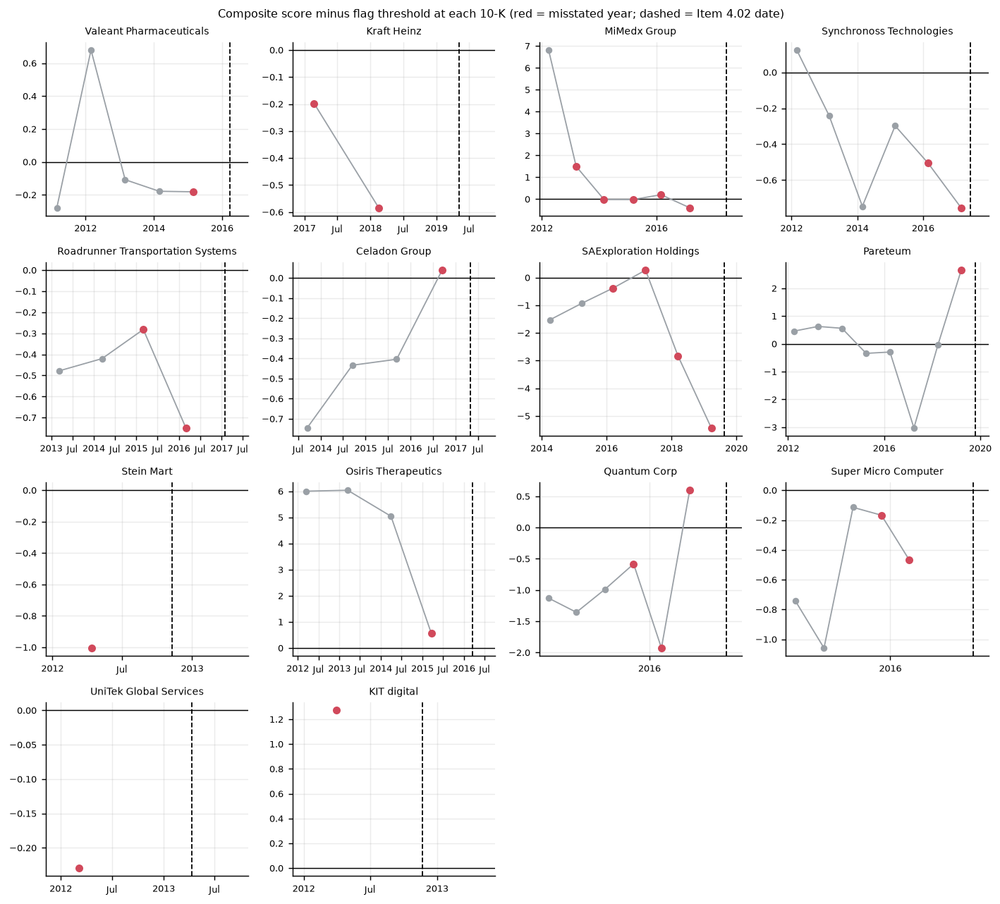
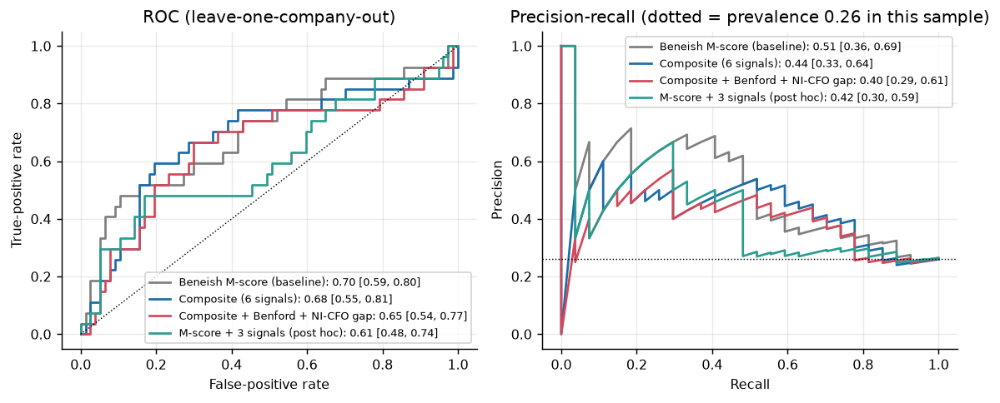
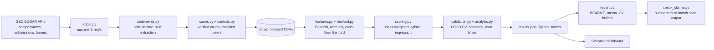

# Forensic Red-Flag Detector

> **Disclaimer.** This is a research and portfolio project. It is **not investment advice**. A "flag" means a filing
> resembles filings of companies that later restated; it indicates *elevated risk worth investigating*, **not proof of
> fraud, intent or wrongdoing**. Many flagged companies are honest, and most manipulators are not flagged.

## Summary

The tool screens US company financials from SEC EDGAR (XBRL) for accounting-manipulation signals - the Beneish M-score,
accruals quality, receivables-versus-revenue and earnings-versus-cash-flow divergence, and a Benford first-digit test -
and asks a practical question: *using only filings available before the problem became public, would these signals have
flagged real companies that later restated or faced SEC accounting action?* It is validated on **14 verified US
cases** against **41 matched healthy peers** (27 misstated and 77 control firm-years, fiscal
2011-2018) with leave-one-company-out cross-validation and company-level bootstrap confidence intervals.
**The honest headline is modest:** the published Beneish M-score has a ROC-AUC of 0.70 (95% CI 0.59 to 0.80), flags 8 of 14
cases ahead of their restatement (median lead 0.98 years) at a 9% false-positive rate, and
my refitted composite score did **not** improve on it. With this few positives the study is a *case-study validation, not
proof of predictive power*.

## Key results

All numbers below are written by `scripts/render_docs.py` from `reports/results.json`; `scripts/check_claims.py` fails the build if
this README disagrees with the code output. Out-of-sample = leave-one-company-out; CIs = 2000-replicate bootstrap over companies.

| Model | ROC-AUC [95% CI] | PR-AUC [95% CI] | Recall (misstated 10-Ks) | False-positive rate (control 10-Ks) | Cases flagged pre-event |
|---|---|---|---|---|---|
| Beneish M-score > -1.78 (baseline) | 0.70 [0.59, 0.80] | 0.51 [0.36, 0.69] | 41% | 9% | 8 of 14 |
| Composite, 6 signals (pre-specified) | 0.68 [0.55, 0.81] | 0.44 [0.33, 0.64] | 30% | 10% | 7 of 14 |
| Composite + Benford + NI-CFO gap | 0.65 [0.54, 0.77] | 0.40 [0.29, 0.61] | 30% | 13% | 6 of 14 |
| M-score + 3 signals (post hoc, exploratory) | 0.61 [0.48, 0.74] | 0.42 [0.30, 0.59] | 33% | 12% | 8 of 14 |

* Evaluation sample: 27 misstated vs 77 control firm-years from 14 case and 41 control companies, so
  26% of rows are positives. That is far above any real-world base rate, so **precision figures flatter live
  performance**: at an assumed 1% prevalence the baseline's implied precision is 4.3% (at 5%: 19.1%).
  These implied figures are arithmetic on the sample's recall and false-positive rate, not measurements.
* The pre-specified composite was statistically indistinguishable from the published baseline (ROC-AUC difference -0.02, 95% CI -0.09 to 0.06).
* The extended composite was statistically indistinguishable from the published baseline (ROC-AUC difference -0.05, 95% CI -0.12 to 0.04).
* The post-hoc anchored composite ranked misstated years WORSE than the published baseline (ROC-AUC difference -0.09, 95% CI -0.14 to -0.05). (This variant was added *after* seeing the pre-specified model underperform, so it is exploratory.)
* Permutation p-values for ROC-AUC (labels shuffled across companies): baseline <0.001, composite 0.007.
  Both rank misstated years better than chance would, although the confidence intervals are wide. Dropping any single case moves the baseline AUC within 0.68 to 0.73.
* Where each test stands alone (raw signal, higher = riskier):

| Signal (raw, higher = riskier) | ROC-AUC [95% CI] |
|---|---|
| mscore | 0.70 [0.59, 0.80] |
| sgi | 0.62 [0.41, 0.83] |
| ni_cfo_gap_rev | 0.58 [0.45, 0.73] |
| tata | 0.58 [0.47, 0.74] |
| lvgi | 0.58 [0.47, 0.70] |
| total_accruals | 0.58 [0.46, 0.74] |
| ar_rev_gap | 0.57 [0.45, 0.68] |
| sloan_accruals | 0.57 [0.40, 0.72] |
| dsri | 0.56 [0.45, 0.67] |
| aqi | 0.55 [0.43, 0.68] |
| depi | 0.49 [0.38, 0.61] |
| sgai | 0.49 [0.34, 0.62] |
| gmi | 0.46 [0.33, 0.59] |
| benford_mad | 0.45 [0.32, 0.59] |

* **Benford:** the first-digit test did **not** separate misstated from control filings (median MAD 0.0146 vs 0.0153;
  44% vs 51% of filings "nonconforming"). Filings hold about 315 reported values, mostly
  sums and rounded totals, so it is a weak filing-level test and I would not use it alone.

### Case-by-case lead times

Lead time = filing date of the earliest flagged misstated-year 10-K to the case cut-off (the earlier of the Item 4.02 date and any
earlier verified public signal).

| Case | Misstated 10-Ks scored | Item 4.02 filed | Beneish flag: lead (yrs) | Composite flag: lead (yrs) |
|---|---|---|---|---|
| Stein Mart | 1 | 2012-11-09 | not flagged | not flagged |
| KIT digital | 1 | 2012-11-21 | 0.6 | 0.6 |
| UniTek Global Services | 1 | 2013-04-12 | not flagged | not flagged |
| Osiris Therapeutics | 1 | 2016-03-15 | 0.7 | 0.7 |
| Valeant Pharmaceuticals | 1 | 2016-03-21 | not flagged | not flagged |
| Roadrunner Transportation Systems | 2 | 2017-01-30 | not flagged | not flagged |
| Celadon Group | 1 | 2017-05-01 | 0.6 | 0.6 |
| Synchronoss Technologies | 2 | 2017-06-13 | not flagged | not flagged |
| MiMedx Group | 5 | 2018-06-07 | 5.0 | 5.0 |
| Quantum Corp | 3 | 2018-09-14 | 1.3 | 1.3 |
| Super Micro Computer | 2 | 2018-11-15 | 3.2 | not flagged |
| Kraft Heinz | 2 | 2019-05-06 | not flagged | not flagged |
| SAExploration Holdings | 4 | 2019-08-16 | 2.4 | 2.4 |
| Pareteum | 1 | 2019-10-21 | 0.6 | 0.6 |




## Architecture



## How to run

```bash
python -m venv .venv && source .venv/bin/activate
pip install -e ".[dev,app,report]"

make reproduce      # offline: analysis -> figures -> README/memo -> claim check, from committed data/processed
make test           # pytest
make lint           # ruff
make dashboard      # Streamlit: watchlist, score breakdown, trends, case studies

# Rebuild the dataset from the SEC (needs an identifying User-Agent; cached and rate-limited to 8 req/s)
export SEC_USER_AGENT="Your Name your.email@example.com"   # or put it in a gitignored .env
make data
```

`make reproduce` needs no network and no credentials. `make data` re-verifies every Item 4.02 citation against EDGAR and fails
loudly if one is wrong.

## Repository layout

| Path | Purpose |
|---|---|
| `src/redflag/` | `edgar` ingestion, `statements` point-in-time extraction, `features`/`benford` signals, `scoring`, `validation`, `analysis`, `plotting`, `report` |
| `tests/` | 60 pytest tests: Beneish hand-calculation, Benford on synthetic data, no-look-ahead guards, bootstrap/CV properties |
| `data/cases/` | hand-curated case table (`cases.csv`) and exclusions with reasons |
| `data/processed/` | committed extracts so the analysis reproduces offline |
| `docs/` | `methods.md`, `case_selection.md` (sources and dates), `verification.md` (hand checks) |
| `reports/` | `memo.md` / `memo.pdf` (2 pages), `results.json`, figures, tables |
| `app/dashboard.py` | Streamlit dashboard |
| `DECISIONS.md` | every judgement call with a one-line reason |

## Data sources

* SEC EDGAR XBRL `companyfacts`, `submissions` and `frames` APIs (public; <https://www.sec.gov/edgar/sec-api-documentation>).
* SEC Form 8-K **Item 4.02** (non-reliance on previously issued financials) filings as the primary source for each case.
* SEC enforcement releases, litigation releases and press releases (URLs and dates in `docs/case_selection.md`); Item 1.03 8-Ks for bankruptcy.
* XBRL coverage starts around 2009 (large filers) to 2011 (smaller filers), so **Enron, WorldCom and other pre-XBRL cases are out of scope**.

## Limitations

* **Small sample, hindsight selection.** 14 cases picked from well-known failures that also had XBRL coverage; results flatter any detector.
  The confidence intervals are wide and there are only a handful of independent companies.
* **Controls are not certified clean.** They are US non-financial peers matched on industry, size and fiscal year with no Item 4.02 filing in
  their EDGAR history; undisclosed restatements or SEC action cannot be ruled out. Matching tiers: 21 at 3-digit SIC, 11 at SIC division, 9 at 2-digit SIC.
* **Sample base rate is unrealistic**, so precision is inflated relative to live use.
* **Heterogeneous misstatements.** Revenue-recognition fraud, tax and inventory errors look different in the numbers; the M-score was fitted on earnings-overstatement cases.
* **Look-ahead discipline limits:** original 10-Ks only, cut-off at the earlier of the Item 4.02 date and a verified earlier signal; I could verify an earlier signal for only some cases.
* **Net income, not continuing-operations income**, enters TATA, so one-off gains (e.g. 2017 tax reform) distort it.
* Hertz (verified case) was dropped because its unclassified balance sheet makes two Beneish indices undefined; others dropped for missing pre-event XBRL (`docs/case_selection.md`).
* The pre-specified composite is refitted with about 27 positives; no tuning was done, and none would be reliable at this size.

## Ethics note

Naming a company in a screen can harm it. Every case here has a public restatement or SEC action on the record and is cited to its
primary source; controls are named only as matched peers with no restatement on record and are not accused of anything. Outputs are framed as screening signals for further human review. The tool should not be used to
trade on, publicise or accuse; false positives are expected and are the *normal* cost of screening.

## What I would do next

1. Widen the sample (more years, more restatement types, SPAC-era restatements) and add quarterly 10-Q signals, where labelled periods are shorter.
2. Pre-register the model and threshold, then score **prospectively** each filing season and report realised hit rates against a realistic base rate.
3. Use income from continuing operations and industry-adjusted indices (z-scores within SIC groups) to cut false positives from M&A and cyclicality.
4. Add text signals (MD&A language, auditor changes, late-filing notices) that often precede restatements and are independent of the numbers.
5. Calibrate the composite probabilistically and report cost-weighted decision curves for an audit-committee audience.

## Licence

MIT - see `LICENSE`.
